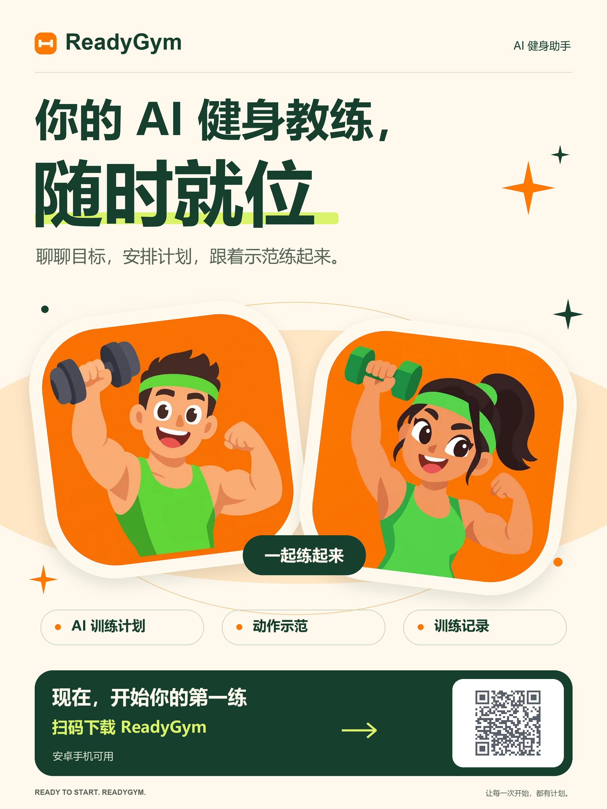

# ReadyGym

**你的 AI 健身教练，随时就位。**

面向健身新手的 Android 健身助手：聊聊目标和时间，确认档案，生成训练计划，跟着练，
再根据练后反馈调整。Kotlin + Jetpack Compose / Spring Boot。

[安卓体验版](https://www.pgyer.com/readygym) · [本地构建](docs/development.md) ·
[Apache-2.0](LICENSE) · [第三方素材说明](THIRD_PARTY_NOTICES.md)

<p align="center"></p>

## 能做什么

- **教练对话**：聊天收集训练档案，确认后保存；支持老用户继续交流。
- **训练计划**：按目标、器械、时间和经验生成草稿，确认后采用；练后反馈可触发调整。
- **跟练与记录**：完成/撤销每组、30 秒起步的休息计时、训练历史与每周统计。
- **动作与器械**：287 条动作目录、按 18 个肌群选动作、器械文字指南；可接入已授权演示素材。
- **拍照与语音**：配置视觉模型后识别器械；系统语音识别和可选讯飞流式转写。
- **体重趋势**：真实称重记录、补记/修改/删除、目标体重；数据本地保存。

训练建议与动作文字未经专业审核，不构成医疗建议；不适或疼痛时停止训练并寻求专业指导。
对新手和恢复训练者保留高风险动作过滤。

## 开源版与体验版

本仓库从 **v0.8.8 / versionCode 27** 的当前源码建立，使用干净的首次提交。
下载入口是作者维护的体验版；自行构建不包含作者密钥、生产服务配置或商业动作图库。

**代码可构建，不代表已配置所有在线功能。** AI、视觉、语音中转与服务端功能需自行配置。
无媒体时动作演示不可用，文字、规则和记录功能保留。媒体接入见 [说明](docs/media-setup.md)。
Android 8.0+；没有 iOS 版本。测试和已知限制见 [验证记录](docs/verification.md)。

## 目录

```text
android/app/    Compose UI、聊天/视觉/语音、Room 本地存储
android/core/   纯 Kotlin：档案、动作筛选、计划契约与校验
server/         Spring Boot：注册、排行榜、反馈、ASR、可选 AI 代理与媒体分发
docs/           开发、媒体接入、验证、宣传海报
third-party/    保留的上游许可与声明
```

## 快速开始

安装 JDK 21、JDK 17、Android SDK 35；用 Android Studio 打开 `android/`。

```sh
cd server
./gradlew test bootRun
```

另一个终端：

```sh
cd android
./gradlew :app:testDebugUnitTest :core:test :app:assembleDebug
```

Windows 使用 `gradlew.bat`。默认 debug 连接模拟器宿主 `10.0.2.2:8080`。
配置自己的 AI、HTTPS 服务和正式签名前，请阅读 [开发说明](docs/development.md)。

## 许可证

原创代码与文档正文使用 **Apache License 2.0**，允许按其条款使用、修改与商业分发。
第三方依赖和数据遵循各自许可；**Gym visual 图片/GIF 未随本仓库分发，不能据代码许可使用**。
保留的一份 CC BY-SA 动画有独立署名与许可。
品牌、角色与宣传图片的范围见 [BRAND_ASSETS.md](BRAND_ASSETS.md)。
