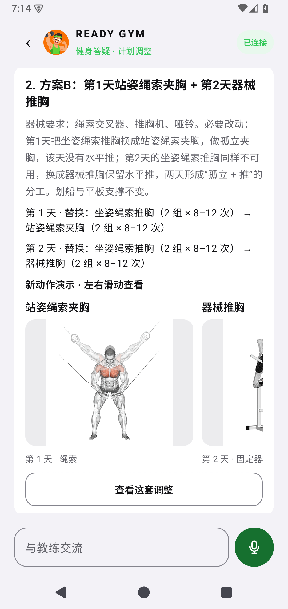
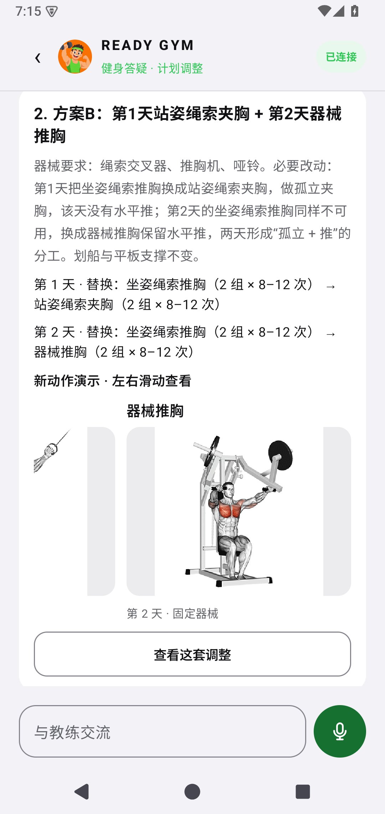
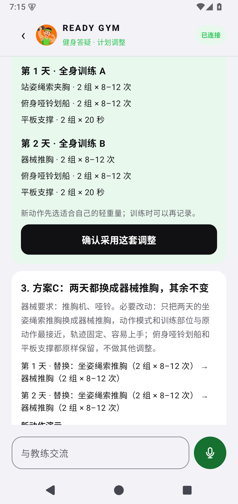
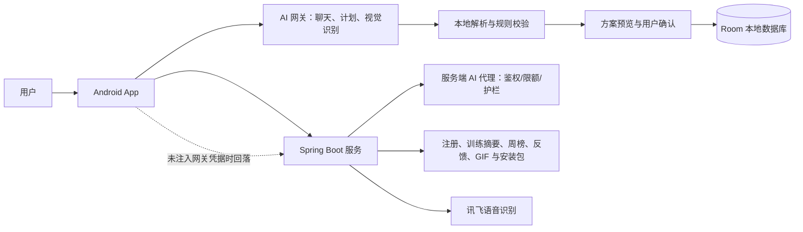

<div align="center">
  
  <h1>Ready Gym</h1>
  <p><strong>从不知道练什么，到知道今天怎么练。</strong></p>
  <p>面向健身新手的安卓 AI 健身教练，用对话制定计划，用演示认识动作，用记录看见进步。</p>
  <p><strong>v0.8.13</strong> · Android 8.0+ · Kotlin / Jetpack Compose · Spring Boot</p>
  <p>
    <a href="https://www.pgyer.com/readygym">下载安装</a> ·
    <a href="https://erfan817.github.io/ReadyGym/">项目作品页</a> ·
    <a href="#功能一览">功能一览</a> ·
    <a href="#开始使用">开始使用</a> ·
    <a href="#技术结构">技术结构</a> ·
    <a href="#工程视角">工程视角</a> ·
    <a href="#本地开发">本地开发</a> ·
    <a href="AGENTS.md">开发手册</a>
  </p>
</div>

## 为什么做 Ready Gym

刚开始健身时，难的往往不只是坚持，还有一连串具体的问题：今天练什么？这个器械怎么用？计划里的动作做不了，能换成什么？上次做到哪一组了？

Ready Gym 把这些问题放进同一个训练流程：先聊清楚你的目标、时间和器械条件，再生成计划；训练时看动作演示、记录每一组，遇到不合适的动作就和教练讨论替代方案。计划的修改会先展示给你，确认之后才生效。

适合希望按计划训练的健身新手，也适合在家用哑铃、徒手练习，或在健身房需要器械使用指引的人。

## 功能一览

| 你想做的事 | Ready Gym 提供的帮助 |
| --- | --- |
| 不知道怎么开始 | 通过聊天收集训练目标、身体资料、每周天数、单次时长和器械条件，确认后建档 |
| 想要一份可执行的安排 | 按档案生成整周训练计划，列出动作、组数、次数或时长；计划经过代码校验 |
| 不喜欢某个动作，或现场缺器械 | 和教练讨论，比较 1–3 套调整方案，查看变化与整周安排后确认采用 |
| 看不懂新动作的名字 | 在选择替代方案前直接看 GIF，了解动作、所需器械及对应训练日 |
| 想补充某个部位的训练 | 点选正面、背面人体图上的 18 个肌群，查看筛选后的动作和演示，再加入指定训练日 |
| 器械不会用 | 浏览 16 台器械的教程，或拍照识别；额外覆盖 9 类常见器械的动作建议 |
| 想知道练了多少、有没有坚持 | 记录每组的次数、时长与重量，查看训练历史、活动热力、肌群分布、勋章和周榜 |
| 想追踪体重变化 | 记录到 0.1 kg，补记日期、修改记录、设置目标，查看体重趋势 |
| 打字不方便 | 按住说话转文字，识别后先回到输入框，检查内容再发送 |

### 用对话调整计划

你可以直接告诉教练：

> “这个动作我不想做，帮我找几个替代。”
>
> “今天健身房没有这台器械，我可以用哑铃。”
>
> “我想调整这个动作的组数和次数。”

教练会结合已保存的档案、当前整周计划和可用动作给出建议。每套方案都会说明调整原因，列出前后变化；涉及新动作时可以先看演示，再决定采用哪套。

- **先预览，再保存**：播放 GIF、左右浏览和选择方案都不会修改当前计划。
- **确认后同步当前训练**：正在进行的训练中，待做动作、组次和重量会跟着更新，已经完成的实际记录保留。
- **新动作重新选重量**：替换动作不会自动沿用旧动作的重量。
- **保存前再次检查**：档案或原计划发生变化时，旧方案不能直接覆盖新状态。

### 跟着计划练，进度留得住

训练页突出当前动作和当前组，支持完成与撤销；次数、时长和重量随组记录。退出后再次打开，可以继续未结束的训练。

训练按本地自然日推进：当天有已结束且至少完成一组的训练，就显示“今天已经训练完了”，下一天恢复下一训练日。设置了固定训练星期时，首页、计划页和开始页会明确显示休息日。当前版本已取消组间休息计时。

### 按自己的条件找动作

动作库共有 **287 个动作**，其中 **60 个 GIF 随 APK 提供**，其余 **227 个通过服务器加载**。动作筛选会参考场地、器械和训练经验；新手与恢复训练者的计划会排除标记为高风险的杠铃动作。

按肌肉选动作时，可以先看演示，再选择加入哪一天；同一天不重复添加同一动作，每天最多 8 个动作。器械指南也可以直接按名称浏览，拍照识别未匹配时可以回到手动选择。

### 用真实记录看变化

统计页汇总已保存的训练记录，展示本周进度、活动热力、肌群平衡与训练日历。体重记录独立保存在本机，支持同日覆盖、历史修改和确认删除，也可以设置或清除目标体重。

没有称重记录时不会生成虚构的历史曲线；档案里填写的体重也不会自动变成过去的称重记录。

## 页面预览

以下为 **0.8.12 正式包在 Android API 35 模拟器中的实际截图**（0.8.13 为增量更新，界面未变）。截图里的训练安排是验证样例。

<table>
  <tr>
    <th>选择前看新动作</th>
    <th>左右浏览多个演示</th>
    <th>预览采用后的整周安排</th>
  </tr>
  <tr>
    <td></td>
    <td></td>
    <td></td>
  </tr>
</table>

GIF 在 App 内动态播放；这里展示的是页面截图。

## 开始使用

1. **安装 App**：前往 [蒲公英下载页](https://www.pgyer.com/readygym)，下载并安装当前安卓版本。已有用户可以在“我的”中检查更新。
2. **完成初次设置**：填写昵称，进入首页；首次使用 AI 功能时阅读并确认资料发送说明。
3. **告诉教练你的情况**：说明目标、每周可练天数、单次时间、场地与器械；核对档案卡片后确认保存。之后再进入聊天，教练会读取已存档案。
4. **生成并查看计划**：到计划页生成训练安排，查看各训练日的动作与组次，也可以按肌肉选择动作补充进去。
5. **开始训练**：按动作逐组记录，完成后查看回顾并反馈感受。需要换动作时回到聊天，先看建议和演示，再确认调整。

## 技术结构

当前正式客户端为 **Kotlin + Jetpack Compose 安卓 App**，业务后端为 **Spring Boot**。AI 聊天、计划生成和照片识别默认由 App 直连 OpenAI 兼容网关（当前发行配置采用 PackyAPI 的 `deepseek-flash`）；当构建未注入网关凭据时，App 会自动回落到服务端 `/api/ai` 代理（带鉴权、按设备每日限额与话题护栏）。两条通路的差异见 [AGENTS.md](AGENTS.md)。



| 层级 | 技术与职责 |
| --- | --- |
| 界面 | Jetpack Compose、Material 3；首页、计划、训练、统计和个人资料 |
| 状态管理 | ViewModel、StateFlow、Kotlin Coroutines；处理请求、页面状态与训练进度 |
| 规则层 | 纯 Kotlin `core` 模块；动作筛选、计划契约、差异比较、自然日推进和会话同步 |
| 本地存储 | Room；保存档案、计划版本、训练组记录和体重数据 |
| 图片与动图 | Coil；APK 内置媒体优先，其余从服务器加载 |
| 业务后端 | Spring Boot 3.4.1、Java 21、Spring Data JPA；默认 H2，可配置 MySQL |
| 分发 | 蒲公英主下载入口，App 内检查更新；服务器保留安装包下载能力 |

### 数据如何流转

- **档案、计划与详细训练记录**：保存在手机本地；AI 建议会按需使用聊天内容、档案与当前计划。
- **体重记录与目标**：保存在本机，与训练档案体重分开管理。
- **训练完成摘要**：结束训练后会尝试上传训练时间、组数与训练量等汇总信息，供周榜使用；打开周榜时也会补传本周记录。
- **语音输入**：优先使用系统识别服务，缺少服务时通过后端转发到讯飞；转写结果先交给用户检查。
- **器械照片**：在拍照识别时压缩后发送到 AI 网关，用于匹配器械教程与动作建议。
- **意见反馈**：提交反馈文字、填写的联系方式及 App 版本、机型和系统信息。

本地数据保存不等于云端备份，当前也没有跨设备恢复本地档案、计划和体重记录的完整功能。
涉及聊天内容、语音、器械照片与反馈的告知同意、留存期限与第三方共享清单，见 [隐私说明](docs/PRIVACY.md)。

## 本地开发

### 环境准备

- JDK 21；Android 编译目标为 Java 17。
- Android SDK 35、Android Studio 或命令行 SDK 工具。
- 使用仓库内 Gradle Wrapper：Gradle 8.9、AGP 8.7.3、Kotlin 2.0.21。
- 如需使用 AI 功能，准备可用的 OpenAI 兼容网关配置。

```bash
git clone https://github.com/Erfan817/ReadyGym.git
cd ReadyGym
```

### 配置客户端

在 `android/local.properties` 中填写 SDK 路径和服务配置。该文件被 Git 忽略，示例中的占位内容需要替换为自己的配置。

```properties
sdk.dir=<本机 Android SDK 路径>

# AI 聊天、计划生成与照片识别
readyGymAiBaseUrl=https://www.packyapi.ai/v1
readyGymAiModel=deepseek-flash
readyGymAiApiKey=<AI 网关密钥>

# 可选：App 内检查蒲公英更新
readyGymPgyerApiKey=<蒲公英 API 密钥>
readyGymPgyerAppKey=<蒲公英 App Key>
```

AI 与更新配置在构建时注入 App；修改后需要重新打包。业务服务地址由 `android/gradle.properties` 中的 `readyGymServiceBaseUrl` 指定，也可通过 Gradle 参数覆盖。

### 测试与构建

在仓库根目录运行：

```bash
# Android app 与 core 单元测试
cd android
./gradlew :app:testDebugUnitTest :core:test

# 调试包 / 正式包
./gradlew :app:assembleDebug
./gradlew :app:assembleRelease

# 后端测试与可部署 jar
cd ../server
./gradlew test bootJar
```

Windows PowerShell 下将 `./gradlew` 换成 `.\gradlew.bat`。正式包启用 R8 与资源压缩，当前个人分发版本沿用 debug 签名。

本地启动后端与模拟器调试：

```bash
# 在 server/ 中启动后端，默认端口 8080
./gradlew bootRun

# 在另一个终端的 android/ 中构建，连接宿主机后端
./gradlew :app:assembleDebug -PreadyGymServiceBaseUrl=http://10.0.2.2:8080
```

讯飞语音、管理员入口和数据库等后端配置通过环境变量提供。详细字段、Windows 构建环境与服务器部署步骤见 [Android 说明](android/README.md)、[开发手册](AGENTS.md) 和 [部署文档](docs/deploy-vps.md)。

### 目录导航

```text
ReadyGym/
├── android/
│   ├── app/              # Compose 界面、ViewModel、网络与本地数据
│   └── core/             # 动作库模型、计划规则、校验与训练逻辑
├── server/               # Spring Boot 业务服务
├── docs/                 # 功能设计、部署与历史验收文档
├── data/                 # 动作数据来源、导入工具与媒体映射
├── releases/             # 版本说明与可提交的验证记录
├── screenshots/          # 已选取的实际页面截图
└── AGENTS.md             # 项目机制、构建方式与维护约束
```

`agent-python/`、`business-java/` 和 `frontend/` 保留了早期 Demo 与实验实现。当前安卓版本以 `android/` 和 `server/` 为准；历史架构说明见 [Foundation Demo 文档](docs/foundation-demo-runbook.md)。

## 版本与验证

当前版本：**0.8.13 / versionCode 32**。

| 版本 | 主要变化 |
| --- | --- |
| 0.8.13 | 训练页沿用上次同动作同组的实际重量、次数与秒数；每完成 3 次训练后次日首页恢复回访，可跳过 |
| 0.8.12 | 调整方案内直接播放新动作 GIF，支持多动作滑动查看和加载失败重试 |
| 0.8.11 | 聊天确认后立即同步当前训练待做动作；明确展示休息日，保存固定训练星期 |
| 0.8.10 | 聊天提供多套计划调整方案，比较变化、预览整周，再明确确认 |
| 0.8.9 | 改善 AI 请求可靠性，训练按自然日推进，取消组间休息计时 |
| 0.8.8 | 新增本机体重记录、目标和趋势图，保留旧版训练数据 |

**0.8.13 测试结果：378 项通过，1 项原有测试跳过。**

| 范围 | 通过 | 跳过 |
| --- | ---: | ---: |
| Android app | 237 | 1 |
| Kotlin core | 131 | 0 |
| Spring Boot server | 11 | 0 |

正式包已在 API 35 模拟器验证：从 0.8.12 覆盖升级后所有数据库表哈希一致；实际重量 18.5kg × 7 次、44 秒记录可沿用且重启后保持；跳过回访可持久化；完成总结与主动反馈分流正确；保存反馈不改动档案与计划。

以上为自动化测试与模拟器验证，**尚未做 0.8.13 真机验收**。详情见 [验证记录](releases/ReadyGym-0.8.13-validation.json)、[更新说明](releases/ReadyGym-0.8.13-notes.txt) 和 [本次功能设计](docs/design/training-carry-recovery-v0.8.13.md)。

## 常见问题

**需要一直联网吗？**

AI 对话、计划生成、照片识别、周榜和在线 GIF 需要网络。已保存计划的查看与本地训练记录、本机体重记录不依赖每次请求 AI；APK 内置的 GIF 可以离线读取。首次注册仍需要连接业务服务。

**换动作会影响我已经完成的组吗？**

确认新方案后，进行中训练的待做部分会更新，已完成的实际记录保留。已结束的训练不会因为修改计划而重新打开。

**想改变每周训练天数，和换动作一样吗？**

调整天数需要先更新并确认档案，再到计划页生成匹配的新计划；聊天中的动作替换方案保持原训练日数量。

**为什么有的演示需要加载？**

60 个常用动作 GIF 随 APK 提供，其他动作通过服务器加载。新方案里的演示加载失败时可以点击“重新加载”，也可以先看名称与说明。

**iPhone 或鸿蒙可以安装吗？**

当前只提供 Android APK，没有 iOS 或原生鸿蒙版本。

## 反馈与交流

遇到问题，可以在 App 的“我的 → 意见反馈”中提交；描述操作步骤、预期结果和实际表现，更方便定位问题。

软件交流群：**QQ 158476703**。App 的“我的 → 软件交流群”提供二维码与群号复制入口。

欢迎通过 [GitHub Issues](https://github.com/Erfan817/ReadyGym/issues) 反馈缺陷或提出功能建议。提交代码前可先阅读 [AGENTS.md](AGENTS.md)，了解计划保存、训练记录、数据迁移与动作筛选的约束。

## 动作素材与使用边界

动作图片与 GIF 保留 **© Gym visual** 署名。项目主人已声明取得 Ready Gym 使用授权；媒体**不属于上游非媒体数据/说明的 MIT 许可范围**，也不属于本项目源码的 Apache-2.0 授权范围，使用本仓库不自动授予任何媒体使用权，第三方须自行向 Gym visual 取得许可。来源与映射见 [动作数据源评估](动作数据源评估.md)、[媒体署名](android/docs/media-attribution.md)、[第三方许可与素材边界](THIRD_PARTY_NOTICES.md) 和 [数据说明](data/README.md)。

Ready Gym 是个人健身辅助项目，训练建议与动作说明未经专业训练或医疗认证；身体疼痛或存在医学限制时，应停止不适合的训练并寻求专业帮助。

## 开源与许可

原创源码与文档正文采用 [Apache License 2.0](LICENSE)。第三方素材、动作媒体与品牌图片
有独立授权边界，见 [NOTICE](NOTICE)、[第三方许可与素材边界](THIRD_PARTY_NOTICES.md)、
[品牌与宣传素材](BRAND_ASSETS.md)。参与贡献前请阅读 [贡献指南](CONTRIBUTING.md)。

本仓库由原先两个公开仓库合并而来：开发主线继续在此维护，
此前的 v0.8.8 开源快照已归档为 [ReadyGym-legacy](https://github.com/Erfan817/ReadyGym-legacy)。

## 工程视角

> 这一节写给想了解实现方式与取舍的人；面向使用者的产品说明见上文。项目作品页：https://erfan817.github.io/ReadyGym/

### 30 秒演示

待补：30 秒操作录屏（建档 → 生成整周计划 → 逐组记录 → 聊天换动作并确认）。上方「页面预览」已有正式包的实际截图（0.8.12 界面，0.8.13 界面未变）；操作录屏尚未录制，未录制前不放占位图。

### 为什么这么设计

| 决策 | 取舍 | 代价 / 边界 |
| --- | --- | --- |
| 默认 App 直连 AI 网关，保留可触发的服务端代理回落 | 少一层延迟与转发成本；缺凭据的构建仍能用 | 直连模式下网关凭据必然随 APK 分发，需可轮换并限制额度；代理通路已有鉴权与按设备每日限额，但预算与视觉能力需与直连对齐 |
| `PlanContract` 契约校验 + 最多两次重试 | 推理模型输出先过代码校验才允许保存 | 多一次调用成本；仍不合规就拒绝，不把无效内容写进历史 |
| 新手 / 恢复训练者双重排除 HIGH_RISK 动作 | `Exercise.allowedFor` 与计划提示词只喂可用动作 | 牺牲动作丰富度，用户要求也不放行 |
| 60 个 GIF 打包进 APK、227 个从服务器加载 | 常用动作离线可看，长尾不撑大安装包 | 长尾演示依赖服务器可达，失败可重试 |
| 计划版本事务化 | 换动作后立即同步当前训练待做部分，已完成实际组记录保留 | 确认前需等待排队中的组保存完成 |
| 手写 RFC6455 WebSocket 客户端 | 服务端持有讯飞连接边收边转，松手后只等收尾 | 需自行维护连接与异常；任何失败回落整段识别接口 |

### 测试基线

0.8.13 正式包 378 项通过、1 项原有测试跳过（app 237 / core 131 / server 11）。网络测试使用注入连接，禁止真实联网。发版基线为 app + core + server 单测全绿。

持续集成见 `.github/workflows/ci.yml`（app / core / server 三模块单测门禁）。覆盖率统计尚未接入，徽章暂不展示。

### 运行数据（待实测）

| 指标 | 数值 | 来源 |
| --- | --- | --- |
| 种子用户数 | 待实测 | 埋点 |
| 4 周留存 | 待实测 | 埋点 |
| 计划生成合规率 | 待实测 | 30 条评测集 × 3 次 |
| 流式 ASR 松手→出字 | 待实测 | 端到端计时 |

未实测前保持「待实测」，不预填、不估算。用例矩阵与报告模板见 [AI 计划评测集](docs/ai-plan-eval.md)。

### 已知限制

- 仅提供 Android APK，暂无 iOS / 原生鸿蒙版本（只读 Web 伴随端在规划中）。
- 档案、计划、训练记录与体重数据保存在本机，没有跨设备同步与云端备份。
- 训练建议与动作说明未经专业训练或医疗认证。
- 动作素材为 © Gym visual 非商用授权，商业化前需替换素材或另取授权。
- 0.8.13 已完成模拟器验证，尚未做真机验收（见「版本与验证」）。

### 延伸阅读

- [项目作品页](https://erfan817.github.io/ReadyGym/) · [技术复盘：手写 WebSocket 与流式语音识别](docs/tech-retrospective.md) · [AI 计划评测集](docs/ai-plan-eval.md)
- [开发手册](AGENTS.md) · [部署文档](docs/deploy-vps.md) · [Android 说明](android/README.md)
